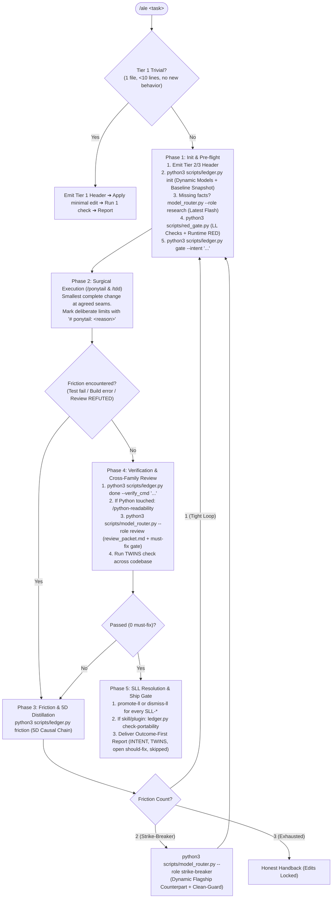

# Agent Loop Engineering (ALE) Harness

> **"The agent forgets, the repo and ledger don't."**
> ALE is the deterministic supervisory harness connecting `/tdd`, `/research`, `/diagnosing-bugs`, `/fable-judge`, `/ponytail-review`, and `/code-review`. It stores session state outside the Git tree, executes invariants before and after edits, and dynamically resolves both Worker Roles and Cross-Family Counterpart Models from the live `agy models` catalog.

## 0. Output Root Override & Portability Contract

Runtime ledgers, model caches, routing overrides (`model_routing.json`), session buffers (`SESSION_LL.md`), and review packets (`review_packet.md`) live outside the repository under `$HOME/tmp/ale_harness/` by default.
Callers and evaluation suites redirect all reads and writes via `ALE_OUTPUT_ROOT` or `--output_dir` / `--base_dir`:

```bash
export ALE_OUTPUT_ROOT="$HOME/tmp/eval_sandbox/agent-loop-engineering"
python3 scripts/ledger.py --output_dir "$ALE_OUTPUT_ROOT" status
```

All paths inside this skill (`scripts/`, `references/`, `templates/`) are referenced relative to the directory containing this `SKILL.md`.

## 1. Non-Negotiable Gates

Every `/ale` execution obeys six deterministic gates:

1. **Line 1 Header**: Emit `Tier <1|2|3> · <Type> · [Impl: <model> | Review: <counterpart>]` on line 1.
   - `Tier 1 (Trivial)`: Single file, `< 10` changed lines, no new behavior -> run one obvious check and finish without spawning subagents.
   - `Tier 2 (Standard)`: Multi-line bugfix, feature slice, or skill update -> full 5-phase loop.
   - `Tier 3 (Architectural)`: Cross-module refactor, schema migration, or ambiguous spec -> requires `plan.md` approval and SHA-256 binding (`scripts/ledger.py bind-plan`).
2. **External Ledger Initialization (`scripts/ledger.py init`)**: Record `base_sha`, pre-existing dirty baseline snapshot (`baseline.patch` / `baseline_dirty_files`), active model, dynamically resolved Counterpart Model and Worker Role models, and `SESSION_LL.md` outside the Git tree.
3. **Pre-Flight `LL_GATE` & Runtime `RED Gate` (`scripts/red_gate.py`)**:
   - Execute all active `Verification Check` rules from `~/knowledgebase/lessons/<project>/LESSONS_LEARNED.md`, repo `docs/LESSONS_LEARNED.md`, and `SESSION_LL.md` (automatically skipping `Superseded`, `Dismissed`, and `Promoted` entries).
   - Record runtime **RED** (confirming a failing test assertion exit code instead of a syntax or import crash) before modifying production code. Behavior-preserving refactors and doc edits must pass `--exempt --reason "..."`.
4. **Friction Budget ($\le 3$) & Cycle-2 Cross-Family Strike-Breaker**:
   - **Cycle 1 Friction**: Stop blind edits, build a tight reproduction loop (`/diagnosing-bugs`), and record a 5D Causal Chain via `scripts/ledger.py friction`.
   - **Cycle 2 Friction (`STRIKE_BREAKER`)**: Hand off the diff, failure log, and invariants to the dynamically resolved flagship Counterpart Model (`scripts/model_router.py --role strike-breaker`). Fallback halts if the first candidate already edited workspace files before failing.
   - **Cycle 3 Friction (`ABORT_HANDBACK`)**: Lock edits and deliver an Honest Handback with observed outputs, `SESSION_LL.md`, and root-cause hypothesis.
5. **Observed `DONE` & Full-Packet Cross-Family Review (Max 3 Rounds)**:
   - Record passing test/build commands via `scripts/ledger.py done --verify_cmd "..."`.
   - Dispatch the Counterpart Model (`scripts/model_router.py --role review`) to audit `git diff <base_sha>` and untracked files across `/fable-judge`, `/ponytail-review`, and `/code-review`. The full uncapped context is written to `<session_dir>/review_packet.md`, and the read-only reviewer can call `read_file` on truncated sections or callers. `VERIFIED_WITH_CAVEATS` is rejected whenever any finding has `severity == "must-fix"`.
   - Run the **Twin Check** (`TWINS: searched <pattern> - found <N> sites`) and `/python-readability` when `.py` files changed.
6. **SLL Resolution, Promotion & Ship Gate**:
   - Resolve every active `SESSION_LL` entry via `scripts/ledger.py promote-ll` (when passing Generalizability, Tool Gap, and Permanence) or `scripts/ledger.py dismiss-ll --reason "..."` (when session-only). `ruling --complete` blocks until zero active `SLL-*` entries remain.
   - Hard-stop before any outward or irreversible action (`git push`, `gh pr create`, release/publish) until the user confirms and `scripts/ledger.py ruling --allow_ship` is recorded.

## 2. Step-by-Step Execution Pipeline



### Phase 1 — Ingestion, Ledger Init & Pre-Flight Gates
1. **Initialize Ledger**:
   ```bash
   python3 scripts/ledger.py init --task "<task>" --tier <2|3> --type <Feature|Bugfix|Refactor|Skill>
   ```
   See [references/model-routing-matrix.md](references/model-routing-matrix.md) for dynamic discovery, `model_routing.json` overrides, and Worker Role mapping, and [references/hooks-and-ledger.md](references/hooks-and-ledger.md) for state rules.
2. **Fact Discovery (`research`)**:
   When external library signatures or unfamiliar modules are involved, dispatch the latest research model via `python3 scripts/model_router.py --role research --prompt "..."` or native `invoke_subagent(Model="flash")`.
3. **Run Executable `LESSONS_LEARNED` Checks & Record Runtime `RED`**:
   ```bash
   python3 scripts/red_gate.py --test_cmd "<pytest/unittest command>"
   # Or for behavior-preserving refactors / docs:
   python3 scripts/red_gate.py --exempt --reason "Pure documentation/refactor with no behavior change"
   ```
4. **Unlock `LL_GATE` & Declare `INTENT`**:
   ```bash
   python3 scripts/ledger.py gate \
     --checked "LL-ARCH-001,SLL-001" \
     --intent "code does <X>; check expects <Y>; spec says <Z>"
   ```

### Phase 2 — Surgical Execution (`/tdd` & `/ponytail`)
1. Apply the **YAGNI Ladder** (`/ponytail`): reuse existing helpers and stdlib before writing new code, and edit only declared seams.
2. Annotate deliberate shortcuts inline (`# ponytail: <ceiling>, upgrade when <trigger>`).
3. Enforce strict typing and docstrings on Python files for `/python-readability`.

### Phase 3 — Friction Adapter, 5D Distillation & Strike-Breaker
Whenever a test fails unexpectedly, compilation breaks, or Phase 4 Review fails:
1. **Halt edits** and distill the 5-Dimensional Causal Chain into the ledger:
   ```bash
   python3 scripts/ledger.py friction \
     --title "<short title>" \
     --trigger "<file/module/surface>" \
     --assumption "<flawed belief held by agent>" \
     --root_cause "<verified technical reality>" \
     --invariant "<positive rule preventing recurrence>" \
     --check "cmd: <verification command>"
   ```
2. **Follow the returned routing directive**:
   - `CYCLE_1_RETRY`: Build a tight reproduction command (`/diagnosing-bugs`), re-run `red_gate.py` & `ledger.py gate`, and fix.
   - `CYCLE_2_STRIKE_BREAKER`: Invoke the dynamic flagship Counterpart Model:
     ```bash
     python3 scripts/model_router.py --role strike-breaker --prompt "Fix the stalled defect using SESSION_LL invariants."
     ```
   - `CYCLE_3_ABORT`: Stop edits and deliver the Honest Handback report.

### Phase 4 — Observed `DONE` & Cross-Family Adversarial Review
1. **Record Observed Verification (`DONE`)**:
   ```bash
   python3 scripts/ledger.py done --verify_cmd "<test and build command>"
   ```
2. **Run Python Readability Gate** (when any `.py` files changed):
   ```bash
   python3 ../python-readability/scripts/check_python.py <modified_py_files>
   ```
3. **Dispatch Cross-Family Review**:
   ```bash
   python3 scripts/model_router.py --role review
   ```
   `model_router.py` writes the uncapped diff, untracked files, baseline dirty-tree attribution, and active invariants to `<session_dir>/review_packet.md`, refreshes the `dispatch_in_progress` lease per candidate, advances through the dynamic cross-family fallback chain on non-zero exits or exit-0 CLI error envelopes, validates the returned verdict enum and `must-fix` count against [templates/review-verdict.schema.json](templates/review-verdict.schema.json), and transitions the ledger status to `"verified"` once both `done` and `review` pass.
4. **Twin Check**: Search the repository for recurring instances of any fixed defect and record `TWINS: searched <pattern> - found <N> other sites: <list or none>`.

### Phase 5 — SLL Resolution, Portability Gate & Final Delivery
1. **Promote, Dismiss, or Retire Invariants**:
   Resolve every active `SESSION_LL` entry before closing the ledger:
   ```bash
   python3 scripts/ledger.py promote-ll --id SLL-001 --category ARCH
   python3 scripts/ledger.py dismiss-ll --id SLL-002 --reason "Session-specific typo, fails Generalizability"
   python3 scripts/ledger.py retire-ll --id LL-ARCH-008 --superseded_by LL-ARCH-009
   ```
2. **Portability Audit** (mandatory when authoring skills or plugins):
   ```bash
   python3 scripts/ledger.py check-portability <skill_or_plugin_dir>
   ```
3. **Outcome-First Delivery**:
   - Line 1: `Tier · Type · [Impl | Review]` header.
   - Conclusion and verification evidence first.
   - Include `INTENT:`, `TWINS:`, any open `should-fix` caveats, `AUTH:` / `PENDING:`, and at most 3 lines of `/ponytail` simplifications (`skipped: [X], add when [Y]`).
